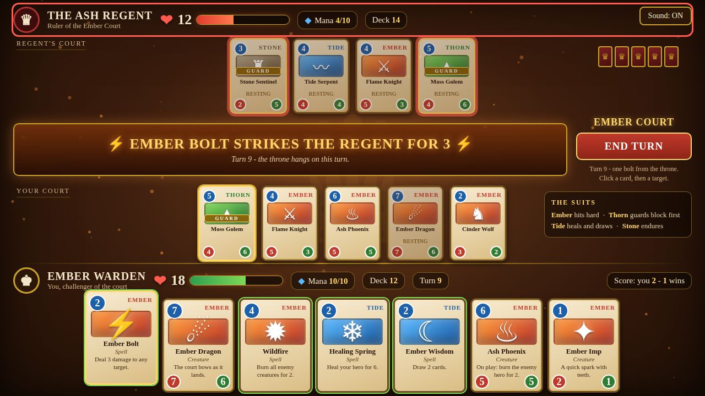
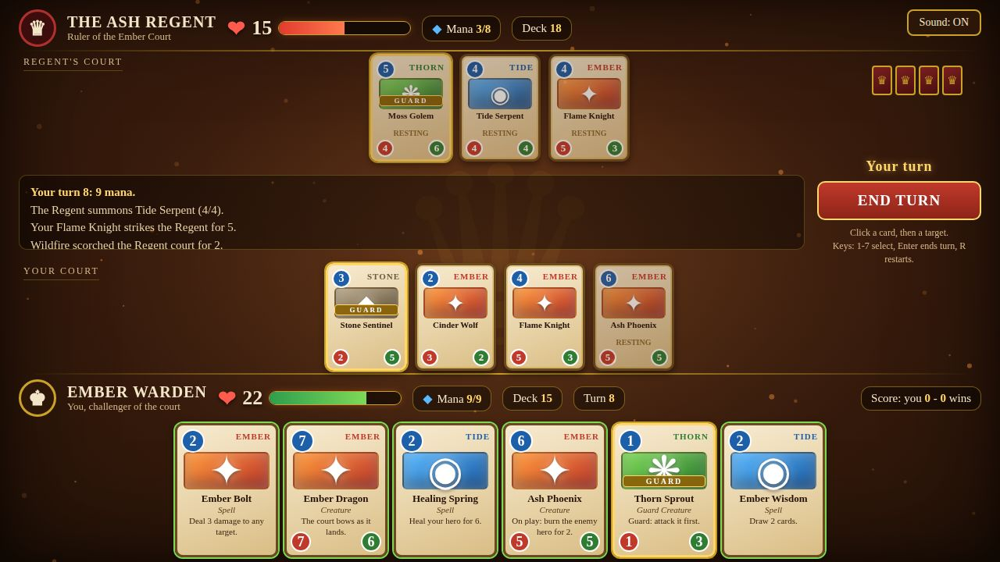
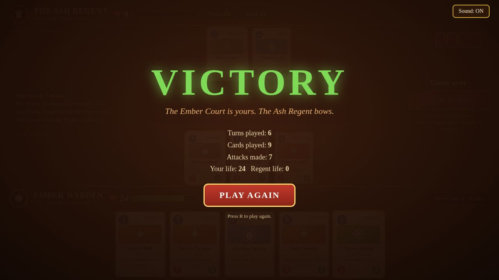
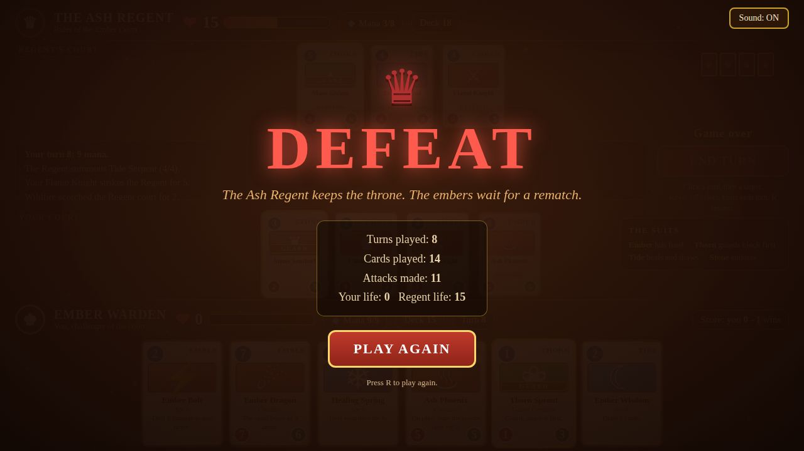

# Ember Court

[](https://make.fun/bounty/best-card-game-20261122-1826?utm_source=github&utm_medium=readme&utm_campaign=best-card-game-20261122-1826)
[](https://make.fun/bounty/best-card-game-20261122-1826/leaderboard?utm_source=github&utm_medium=readme&utm_campaign=best-card-game-20261122-1826)
[](https://make.fun/bounty/best-card-game-20261122-1826?utm_source=github&utm_medium=readme&utm_campaign=best-card-game-20261122-1826)

A turn-based card battler. You are the Ember Warden, challenging the Ash
Regent for the throne of cinders. Both sides start at 30 life. Reduce the
Regent to 0 life before yours reaches 0.

## Screenshots






## How to play

- Each turn you gain mana crystals: 1 on turn 1, up to 10. Mana refills
  every turn. You also draw a card each turn. Your hand holds at most 7
  cards and your court holds at most 5 creatures.
- Click a card in your hand to select it. Creatures go straight to your
  court; spells that need a target ask you to click an enemy creature or
  the Regent. A card costs mana equal to its blue number.
- Creatures attack with their red number and have health shown in green.
  New creatures rest for one turn before they can attack. When a creature
  attacks another creature, both deal damage to each other.
- **Guards** must be attacked before anything else. Spells can still burn
  past a guard and hit the Regent directly.
- Click one of your ready creatures, then click an enemy creature or the
  Regent to attack. Click END TURN when you are done. The Regent plays
  its own hand with simple, readable AI each turn.
- If your deck runs out, you take fatigue damage that grows by 1 each
  time you would draw.

## Cards

Four suits, 15 original card designs in a 30-card deck:

- **Ember** hits hard: Ember Imp, Cinder Wolf, Flame Knight, Ash Phoenix,
  Ember Dragon, Ember Bolt, Wildfire.
- **Thorn** guards: Thorn Sprout, Moss Golem.
- **Tide** heals and draws: Tide Serpent, Tide Herald, Healing Spring,
  Ember Wisdom.
- **Stone** endures: Stone Sentinel.
- Spells: Ember Bolt (3 damage to any target), Wildfire (2 damage to all
  enemy creatures), Healing Spring (heal 6), Ember Wisdom (draw 2).

## Controls

- Mouse: click a hand card to select it, click an enemy creature or the
  Regent to target, click END TURN to pass.
- Keyboard: keys 1-7 select a hand card, Enter ends the turn, Esc cancels
  a selection, R restarts after a win or loss.
- Sound: synthesized with WebAudio only, toggle with the Sound button.

## How to run

Serve the `game/` folder with any static HTTP server and open
`index.html` in desktop Chrome. For example:

```
cd game
python3 -m http.server 8080
```

Then open http://localhost:8080. The game makes zero network requests:
every script, style, image and sound is a file under `game/` or drawn
procedurally in code. All art is original, drawn with CSS gradients and
shapes. No third-party assets.

## Screenshots

`?shot=title` shows the title screen, `?shot=table` a mid-game table,
`?shot=win` the victory screen, `?shot=loss` the defeat screen. Each
state paints synchronously and sets `window.__shotReady` to true.

## License

MIT. See LICENSE.
